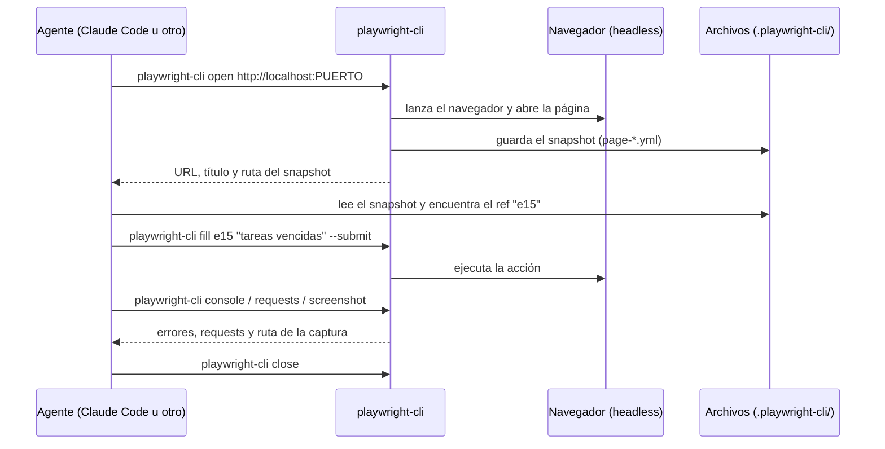

# Playwright para agentes de código: qué es y cómo incorporarlo

- **Fecha:** 2026-10-22
- **Tipo:** investigación exploratoria. No es un requerimiento aprobado ni un plan de implementación.
- **Pregunta:** ¿Qué es Playwright, para qué sirve, de qué formas se puede usar con Claude Code y otros agentes, y por qué conviene usar la CLI con skills dentro del flujo SDD de este proyecto?
- **Audiencia:** el equipo, para entender la herramienta antes de decidir un work item.

> **Convención del documento.** Los **hechos** salen de las fuentes oficiales listadas al final. Las **hipótesis** y **recomendaciones** se marcan como tales.

---

## 1. Qué es Playwright

**Playwright** es un framework open source de Microsoft para **automatizar navegadores**. Maneja Chromium (Chrome y Edge), Firefox y WebKit (el motor de Safari) con una misma API. Nació para hacer **tests end-to-end (E2E)**, es decir, tests que usan la aplicación como lo haría una persona: abren la página, hacen clic, escriben y verifican lo que se ve.

El ecosistema tiene varias piezas, y conviene no confundirlas:

| Pieza | Paquete | Para qué sirve |
|---|---|---|
| **Playwright Test** | `@playwright/test` | Runner de tests E2E. Se escriben archivos `*.spec.ts` y se ejecutan con `npx playwright test`. |
| **Playwright MCP** | `@playwright/mcp` | Servidor MCP que le da a un modelo de IA herramientas para manejar el navegador. |
| **Playwright CLI** | `@playwright/cli` | Línea de comandos (`playwright-cli ...`) pensada para agentes de código, con skills opcionales. |
| **Test Agents** | Vienen con Playwright Test | Tres agentes (Planner, Generator y Healer) que planifican, generan y reparan tests E2E con ayuda de un LLM. |

### Idea central para agentes: snapshots de accesibilidad

Las herramientas para agentes (MCP y CLI) **no trabajan con capturas de pantalla**. Le pasan al modelo un **snapshot del árbol de accesibilidad**: una lista estructurada de los elementos de la página (botones, campos, textos), donde cada uno tiene una referencia corta (`e15`, `e21`). El agente lee el snapshot y actúa sobre la referencia, por ejemplo con `click e15`.

Ventajas de este enfoque (según la documentación):
- No necesita un modelo de visión.
- Es determinista: el agente actúa sobre un elemento concreto, no sobre coordenadas de píxeles.
- Es más barato y más rápido que interpretar imágenes.

---

## 2. Para qué escenarios sirve

| Escenario | Ejemplo en este proyecto |
|---|---|
| **Verificar un cambio de UI** | Después de implementar algo en el Gantt, el agente levanta la app, navega, revisa consola y red, saca una captura y la adjunta como evidencia. |
| **Smoke tests de UI** | Abrir el chat, preguntar «tareas vencidas» y verificar que aparezca la tabla armada por código. |
| **Reproducir bugs** | «Abrí el Dashboard, cambiá el Sector y decime qué error aparece en consola.» |
| **Generar tests E2E permanentes** | Convertir un flujo verificado en un `*.spec.ts` que quede en el repo (con `recording-*`, `generate-locator` o los Test Agents). |
| **Revisar red y consola** | Ver qué requests OData o SSE dispara la UI, sus estados y sus errores. |
| **Emulación** | Dispositivo móvil, modo oscuro, `reduced-motion`, contraste forzado. |
| **Documentación y demos** | Capturas, PDF y video con capítulos de un flujo. |
| **Mock de red** | Interceptar rutas (`route`) para simular respuestas o errores del backend. |

**Hecho relevante:** `.sdd/context/project.md` declara en "No incluye": *"Tests end-to-end y de UI automatizados"*. Playwright cubre justamente ese hueco.

---

## 3. Formas de incorporarlo

### 3.1 Plugin del marketplace de Claude Code

- Es el plugin `playwright@claude-plugins-official` (autor: Microsoft).
- **Hecho:** el plugin no agrega lógica propia. Su `.mcp.json` solo registra `npx @playwright/mcp@latest`.
- **Hecho:** en este equipo ya está instalado con ámbito `project` para este repositorio.
- **Sirve solo para Claude Code.**

### 3.2 Playwright MCP registrado a mano

```bash
claude mcp add playwright npx @playwright/mcp@latest
```

Otra opción es versionarlo en el `.mcp.json` del proyecto para que lo tenga todo el equipo:

```json
"playwright": {
  "command": "npx",
  "args": ["@playwright/mcp@latest", "--isolated", "--caps=testing"]
}
```

- Expone unas 20 herramientas base: navigate, click, type, fill_form, snapshot, screenshot, console_messages, network_requests, tabs, etc.
- Hay grupos opcionales que se activan con `--caps=`: `network`, `storage`, `devtools`, `vision`, `pdf`, `testing` y `config`.
- **Aplica a cualquier cliente MCP** (VS Code, Cursor, Claude Desktop, Claude Code), pero cada cliente se configura por separado.

### 3.3 Playwright CLI + skills (la opción recomendada en la sección 4)

```bash
npm install -g @playwright/cli@latest    # o como dependencia local, con npx
playwright-cli install --skills          # instala las skills para el agente
```

El agente usa la CLI ejecutando comandos de shell. La skill le enseña qué comandos existen y cómo usarlos.

### 3.4 Playwright Test + Test Agents

```bash
npm init playwright@latest                 # instala @playwright/test
npx playwright init-agents --loop=claude   # genera las definiciones de agentes para Claude Code
```

- **Planner** explora la app y escribe un plan de tests en Markdown (`specs/`).
- **Generator** convierte el plan en tests (`tests/*.spec.ts`) y valida selectores contra la app en vivo.
- **Healer** corre los tests, inspecciona la UI cuando algo falla y propone correcciones.
- **Hecho:** la documentación indica que estas definiciones se apoyan en herramientas MCP y que hay que regenerarlas cuando se actualiza Playwright.
- **Es complementario** a la CLI. La CLI verifica de forma interactiva; Playwright Test deja tests permanentes que se pueden correr en CI.

### Comparación

| Criterio | Plugin / MCP | CLI + skills | Playwright Test |
|---|---|---|---|
| Independiente del agente | Parcial (solo clientes MCP) | **Sí** (cualquier agente con shell) | Sí (son tests de código) |
| Costo en tokens | Alto (definiciones de herramientas y snapshots en el contexto) | **Bajo** (el snapshot va a un archivo) | No aplica en ejecución |
| Evidencia en archivos | Parcial | **Sí** (snapshots, capturas, trazas, video) | Sí (reportes y trazas) |
| Ideal para | Exploración larga con estado, tests que se reparan solos | Verificación de un agente de código | Regresión permanente y CI |
| Permanencia | Sesión | Sesión, más evidencia | Repositorio |

---

## 4. Por qué nos conviene la CLI

1. **No depende del agente.** `playwright-cli` es un comando de shell, así que lo puede usar Claude Code, Copilot o cualquier agente que ejecute comandos. Sin skills, el agente igual descubre los comandos con `playwright-cli --help`. Esto va en línea con un flujo SDD que no debería depender de un proveedor.
2. **Gasta menos tokens.** **Hecho:** el README de Microsoft recomienda la CLI para agentes de código porque evita cargar definiciones de herramientas grandes y árboles de accesibilidad completos en el contexto. El snapshot queda en un archivo (`.playwright-cli/page-*.yml`) y el agente lee solo lo que necesita. Para `sdd-verifier`, que además lee spec, plan y tests, esto importa.
3. **Encaja con la evidencia de SDD.** Capturas, PDF, trazas, video y snapshots quedan como archivos que pueden ir al directorio de evidencia del work item y citarse en el `verification-report.md`.
4. **Es reproducible.** Una verificación queda como una secuencia de comandos que una persona puede volver a ejecutar, en lugar de una conversación con un servidor.
5. **Se controla con los permisos que ya existen.** Los comandos pasan por `Bash`, así que `.claude/settings.json` (`allow`, `ask`, `deny`) y el hook de protección de secretos los gobiernan como a cualquier otro comando.

**Cuándo sigue conviniendo MCP (hecho, según el README):** en exploración larga y autónoma con estado persistente, introspección intensiva de la página o tests que se reparan solos, donde el costo de tokens pesa menos. No son excluyentes: se puede usar CLI para verificar y MCP para casos puntuales.

---

## 5. Cómo funciona la CLI a grandes rasgos



### Conceptos clave

- **Sesión:** el navegador queda vivo entre comandos. Cada comando es un proceso corto que se conecta a esa sesión.
  - `-s=nombre` usa sesiones con nombre; sirven para paralelizar o separar contextos.
  - `list`, `close-all` y `kill-all` administran las sesiones.
  - Una sesión headless se cierra sola tras 1 hora sin comandos (se cambia con `--idle-timeout`).
- **Perfil:**
  - Por defecto vive **en memoria**: cookies y storage persisten durante la sesión y se pierden al cerrarla.
  - `--persistent` o `--profile=<ruta>` guardan el perfil en disco.
  - `state-save` y `state-load` guardan y restauran cookies y storage.
- **Modo:** headless por defecto; `--headed` muestra el navegador.
- **Navegador:** `--browser=chrome|firefox|webkit|msedge`, más `--device` y `--mobile`.
- **Cómo apuntar a elementos:** por ref del snapshot (`e15`), por selector CSS o por locator de Playwright (`"getByRole('button', { name: 'Enviar' })"`, `"getByTestId('...')"`).
- **Configuración:** `.playwright/cli.config.json`, o el archivo que indique `--config`. Opciones relevantes:
  - `outputDir` y `outputMode`: dónde y cómo se escribe la salida.
  - `network.allowedOrigins` y `network.blockedOrigins`.
  - `timeouts.action` y `timeouts.navigation`.
  - `testIdAttribute`.
  - `codegen`.

### Comandos por grupo

| Grupo | Comandos principales |
|---|---|
| Básicos | `open`, `goto`, `click`, `fill [--submit]`, `type`, `select`, `check`, `hover`, `drag`, `upload`, `snapshot`, `find`, `eval`, `dialog-accept` |
| Navegación y teclado | `go-back`, `reload`, `press`, `keydown` |
| Evidencia | `screenshot [--filename]`, `pdf`, `tracing-start` y `tracing-stop`, `video-start` y `video-stop`, `video-chapter` |
| Diagnóstico | `console [nivel]`, `requests`, `request <i>`, `highlight`, `show` (panel visual de sesiones) |
| Código | `recording-start` y `recording-stop`, `generate-locator <ref>`, `run-code` |
| Estado | `state-save` y `state-load`, `cookie-*`, `localstorage-*`, `sessionstorage-*` |
| Red y emulación | `route`, `unroute`, `set-color-scheme`, `set-reduced-motion`, `set-contrast` |
| Pestañas | `tab-list`, `tab-new`, `tab-select`, `tab-close` |

### Ejemplo de verificación (hipotético, sobre el chat local)

```bash
playwright-cli -s=verify open http://localhost:<puerto-ui5>/index.html
playwright-cli -s=verify snapshot                          # el agente ubica el input del chat
playwright-cli -s=verify fill e12 "tareas vencidas" --submit
playwright-cli -s=verify console error                     # ¿errores de UI5 o SSE?
playwright-cli -s=verify requests                          # ¿el request al backend respondió 200?
playwright-cli -s=verify screenshot --filename=evidence/chat-vencidas.png
playwright-cli -s=verify close
```

Los refs (`e12`) son ilustrativos: los asigna cada snapshot.

---

## 6. Cómo incorporarlo al proyecto

> Estos son pasos sugeridos para un futuro work item (por ejemplo, un `fast-change`). No es un plan aprobado.

1. **Instalar la CLI con versión fija.**
   - *Recomendación:* como dependencia de desarrollo (`npm i -D @playwright/cli`) en lugar de instalación global, para que todos usen la misma versión.
   - Instalar los navegadores con `npx playwright install chromium`. En WSL o Linux pueden faltar dependencias del sistema: `npx playwright install-deps`.
2. **Instalar las skills** con `playwright-cli install --skills`.
   - Revisar qué archivos genera y en qué ruta. **No verificado:** la documentación no indica el destino exacto.
   - Versionar las skills si corresponde.
3. **Configurar** `.playwright/cli.config.json`:
   - `outputDir` apuntando a una carpeta de evidencia.
   - `allowedOrigins` limitado a `localhost`.
   - Timeouts adecuados al primer arranque de UI5.
4. **Ignorar artefactos efímeros en Git:** agregar `.playwright-cli/` (y la carpeta de salida, si no es la de evidencia) al `.gitignore`.
5. **Permisos** (`.claude/settings.json`, editable solo por una persona porque `.claude/**` está protegido):
   - Agregar `Bash(playwright-cli *)` (o `Bash(npx playwright-cli *)`) a `allow` para no recibir una confirmación por cada comando.
   - Mantener `run-code` y `eval` bajo revisión, porque ejecutan JavaScript arbitrario.
6. **Ambiente de prueba:** usar `npm run dev:all` en `src/`. Levanta CAP y la UI5 sin FLP, con `AFC_MOCK_TOOLS=true`, así que no hace falta AFC real. El puerto de la UI5 lo informa `fiori run` al arrancar.
7. **Integrarlo al flujo SDD:**
   - Definir en el procedimiento o la skill de `verify` un paso de **smoke de UI** que use la CLI y deje la evidencia en el directorio de evidencia del work item.
   - Si se quiere como capacidad formal, registrarla en `.sdd/registry/capabilities.yaml`. Está protegido, así que lo debe hacer una persona.
8. **Opcional, en una etapa posterior:** convertir los flujos verificados en tests permanentes con `@playwright/test` (y, si suma, los Test Agents) para tener regresión en CI.

---

## 7. Riesgos y consideraciones

| Riesgo | Detalle | Mitigación |
|---|---|---|
| No es un límite de seguridad | **Hecho:** Microsoft lo declara explícitamente. `run-code` y `eval` ejecutan JavaScript arbitrario. `allowedOrigins` filtra sitios pero no protege. | Usarlo solo contra ambientes locales o de prueba; dejar `run-code` en `ask`. |
| Autenticación en BTP | Los ambientes desplegados usan XSUAA y requieren login real. | Local con mocks. Si alguna vez se necesita un ambiente real: `state-save` y `state-load` o `attach --extension`, **nunca** credenciales en la configuración ni en el repo. |
| Evidencia con datos sensibles | Las capturas y trazas pueden incluir datos de AFC. | En local se usan mocks; revisar antes de versionar evidencia. |
| Dependencias del navegador en WSL | Chromium headless requiere librerías del sistema. | `npx playwright install-deps`. |
| Herramienta joven | La CLI y los Test Agents evolucionan rápido (hay comandos experimentales, como WebMCP). | Fijar versión y revisar el changelog al actualizar. |
| Solapamiento con `chrome-devtools-mcp` | Ya está instalado en el equipo. | Usar `chrome-devtools-mcp` para rendimiento, memoria y Core Web Vitals, y Playwright para flujos, verificación y tests. |

---

## 8. Recomendación

- **Recomendación:** adoptar **Playwright CLI + skills** como herramienta de verificación de UI del flujo SDD (sobre todo para `sdd-verifier`), con versión fija y alcance local.
- **Recomendación:** mantener el plugin MCP instalado solo para exploración puntual.
- **Hipótesis a validar:** el ahorro de tokens frente a MCP en este repo. Se puede medir con una misma verificación hecha con ambos.
- **Decisión pendiente (del usuario):** si se abre un work item para integrarlo y con qué alcance: solo la CLI de verificación, o también tests permanentes con `@playwright/test`.

---

## Fuentes consultadas

- Playwright, sitio oficial: <https://playwright.dev/>
- Playwright Test Agents: <https://playwright.dev/docs/test-agents>
- Playwright MCP (README): <https://github.com/microsoft/playwright-mcp>
- Playwright CLI (README): <https://github.com/microsoft/playwright-cli>
- Plugin en el marketplace de Claude: <https://claude.com/marketplace/plugins/playwright>
- Código del plugin (`.mcp.json` y `.claude-plugin/plugin.json`): <https://github.com/anthropics/claude-plugins-official/tree/main/external_plugins/playwright>
- Contexto del proyecto: `.sdd/context/project.md`, `.mcp.json`, `src/package.json`

**Limitación:** Context7, que el procedimiento `research-topic` pide como complemento, no estaba disponible como herramienta en la sesión de investigación. Todo el contenido sale de la documentación oficial.
