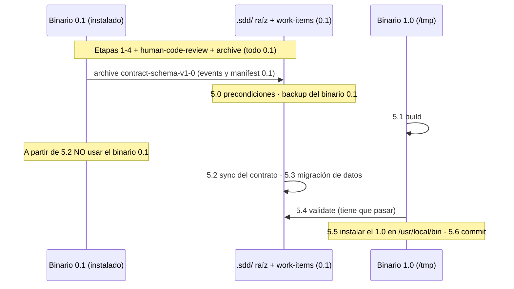

# Plan de implementación: Migrar schema_version del contrato a 1.0

> Nota: el front-matter de este artefacto queda en `"0.1"` a propósito. El work item se
> ejecuta con el binario instalado 0.1, que exige `"0.1"`. Se migra en la Etapa 5 (post-archive).

## Resumen y contexto

**Qué y por qué.** Como parte del release v1.0.0, la versión del **contrato** (`schema_version`)
pasa del literal `"0.1"` a `"1.0"` (formato major.minor, no `"1.0.0"`). Es un corte duro: el
motor escribe y exige `"1.0"` en config, registry de capabilities, workflows, `adapter.yaml`,
manifests (`schema_version` y `workflow.version`), metadata de artefactos (front-matter) y
markers de transacciones de archive y cancel. La única excepción, y es temporal:
`event.schema.json` acepta `["0.1", "1.0"]` para que los `events.jsonl` históricos sigan siendo
inmutables. No hay motor de migración. Los proyectos existentes se migran a mano con una guía.
La versión del **producto** (tag vía ldflags en `cmd/version.go` y `release.yml`) queda fuera
del alcance.

**Fuente de los requisitos.** Las decisiones 1 a 4 las aprobó el usuario y están en el brief
del orquestador y en `manifest.yaml` (`input.summary`). Este `fast-change` no tiene una spec
formal. La trazabilidad usa los IDs de requisito **R1–R8** de abajo.

| ID | Requisito |
| --- | --- |
| R1 | El motor escribe `"1.0"` en todo lo que genera (manifests, `workflow.version`, eventos nuevos, markers, artefactos desde templates). |
| R2 | El motor exige `"1.0"` en config, registry, workflows, manifests, metadata de artefactos y markers. Rechaza `"0.1"` con un error claro. |
| R3 | `event.schema.json` acepta `enum ["0.1","1.0"]` y documenta que es una excepción temporal. Los eventos nuevos son `"1.0"`. |
| R4 | El contrato fuente `src/.sdd/` y `src/adapters/claude-code/adapter.yaml` pasan a `"1.0"`. Los fixtures y tests se actualizan. |
| R5 | La documentación y las specs que describen la versión del contrato se actualizan. El wording BETA queda excluido. |
| R6 | Hay una checklist de migración manual para proyectos instalados y un texto de CHANGELOG con "migración" como Pendiente. |
| R7 | Dogfooding: se sincroniza el `.sdd/` raíz y se migran los datos propios del repo sin desalinear el binario instalado y los datos. |
| R8 | Verificación: build, vet y test, smoke en un dir temporal, eventos mixtos 0.1/1.0 válidos, manifest 0.1 rechazado y `git grep` sin literales residuales. |

**Áreas afectadas.**

- Go, dominio: `internal/domain` (nueva constante, eventos, work item, mensaje de validación).
- Go, infra: `internal/infra` (config, lectura de manifest y workflow, metadata de artefactos, markers, `validate`).
- Contrato de datos: `src/.sdd/{config.yaml, registry, schemas, workflows, templates, tests/fixtures}` y `src/adapters/claude-code/adapter.yaml`. El contrato se embebe en el binario con `go generate` (`tools/syncsdd`, `tools/syncadapters`, salida a `src/cli/embeds/`, que está en gitignore).
- Docs y conocimiento: `.sdd/context/specs/*.md`, `.sdd/context/architecture/data-modeling.md`, `docs/GUIA_INSTALACION.md`.
- Datos del repo (post-archive, los ejecuta el usuario): el `.sdd/` raíz y `.sdd/work-items/**`.
- No hay dependencias externas nuevas.

**Esfuerzo estimado: medio.** Unos 30 archivos, cada uno con un cambio mecánico y localizado,
más dos guards nuevos y tests. El riesgo está en el orden del dogfooding, no en la complejidad
del código.

## Enfoque y decisiones

### D1. La versión es `"1.0"` (major.minor) y el corte es duro (R1, R2)

Se mantiene el formato actual (`"0.1"` → `"1.0"`). Los JSON Schemas siguen usando `const`
(salvo el de eventos). Descartado: aceptar `["0.1","1.0"]` en todos los documentos. Va contra
la decisión aprobada y deja abierta la mezcla de contratos.

### D2. Una sola fuente de verdad en Go: `domain.ContractSchemaVersion` (recomendado)

Archivo nuevo `src/cli/internal/domain/contract_version.go`:

```go
package domain

import "fmt"

// ContractSchemaVersion is the only SDD contract version this engine writes and accepts for
// config, capability registry, workflows, work-item manifests (schema_version and
// workflow.version), artifact metadata and archive/cancel transaction markers.
//
// Temporary exception: .sdd/schemas/event.schema.json also accepts "0.1" so historical
// events.jsonl lines stay immutable. The engine never writes "0.1" events (see NewEvent).
// Remove the exception once a migration command/script between versions exists.
const ContractSchemaVersion = "1.0"

// ValidateContractSchemaVersion rejects any document written for another contract version.
func ValidateContractSchemaVersion(subject, version string) error {
	if version == ContractSchemaVersion {
		return nil
	}
	return fmt.Errorf(
		"%w: %s schema_version %q is not supported; this sdd-cli requires %q (migrate the project manually, see docs/GUIA_INSTALACION.md)",
		ErrSchemaValidation, subject, version, ContractSchemaVersion,
	)
}
```

- **Por qué.** Hoy hay 9 literales repartidos en dominio e infra, con 4 mensajes distintos. Una constante evita que el código diverja en el próximo cambio de versión. La función le da a todos los puntos el mismo mensaje y el mismo error sentinel (`ErrSchemaValidation`, que `cmd/root.go:174` ya mapea).
- **Capa.** Es una regla del dominio (qué contrato entiende el motor). Infra depende de dominio, nunca al revés. Cumple SRP: un archivo, un concepto.
- **Lista legacy en Go para eventos: no se crea.** Ningún código Go compara la versión de un evento. La excepción se aplica solo en `event.schema.json`, así que una constante Go `LegacyEventSchemaVersions` sería código muerto (YAGNI). La excepción queda fijada por un test de consistencia (D6) y documentada en el doc-comment de la constante y en el `$comment` del schema.
- **Descartado.** Reemplazar los literales `"0.1"` por `"1.0"` sin más deja la misma deuda. Un tipo `Version` con parseo semver es abstracción sin un problema real que resolver.

### D3. Guards Go independientes de los schemas del proyecto (recomendado, R2)

Los JSON Schemas se leen del `.sdd/schemas/` del **proyecto**, que son datos editables por el
usuario. Si alguien instala el binario 1.0 sin migrar, hoy pasaría esto: con schemas viejos,
`status` funciona y luego `begin` falla con un mensaje opaco
(`schema validation failed: value must be "0.1"`) porque el evento nuevo es 1.0. Con schemas
nuevos, el mensaje no nombra el campo (`ValidateYAML` devuelve solo `violations[0].Message`).
El motor tiene que hacer cumplir **su** versión sin depender de esos archivos. Hay cuatro puntos
de enforcement, todos usan `domain.ValidateContractSchemaVersion`:

1. **Manifest y workflow en las rutas de lectura** (`fs_repository.go`). Un helper no exportado `requireContractSchemaVersion(subject, data)` hace un probe del campo `schema_version` **antes** de `ValidateYAML`, en `readWorkItemAt` y en `FSWorkflowRepository.GetWorkflow`. Si el YAML está mal formado, el helper devuelve `nil` y deja que la validación de schema reporte como hoy. Así no cambia el tipo de error para manifests rotos.
2. **Metadata de artefactos.** Se extiende `validateArtifactMetadata` (`artifact_manager.go:213`) para leer también `schema_version`. Esa función ya tiene 6 llamadas: render en begin, templates en `GetWorkflow`, el stage de archive y las checks `template.identity_valid` y `artifact.identity_valid` de `validate`. Cubre templates y artefactos sin código nuevo en esos lugares.
3. **`validate`** (`fs_validation_inspector.go`). Se agregan las checks `workflow.schema_version_supported` y `manifest.schema_version_supported`, que repiten el patrón de `config.` y `registry.schema_version_supported`. Así `validate` sirve como **verificador de la migración**: lista cada archivo que quedó en 0.1, aunque los schemas del proyecto estén desactualizados.
4. **Config y registry.** Usan la función común en lugar del literal.

- **Descartado.** Meter la regla en `Workflow.SemanticViolations` y `WorkItem.ViolationsAgainst`. Muchos tests construyen `domain.WorkItem{}` sin `SchemaVersion` y llaman a `ValidateAgainst` (por ejemplo `work_item_validation_test.go:44-58`, `state_machine_test.go`, `work_item_cancel_test.go`), así que se romperían en cadena. Además mezcla la versión del sobre del contrato con la semántica del workflow.
- **Descartado.** Cambiar `ValidateYAML` para que incluya `InstancePath` en el mensaje. Cambia el mensaje de error de todos los comandos, que está fuera del alcance.

### D4. Excepción de eventos en `event.schema.json` (R3)

```json
"schema_version": {
  "$comment": "TEMPORARY: \"0.1\" is accepted only so historical events.jsonl lines stay immutable. The engine writes \"1.0\". Remove \"0.1\" once a migration command/script exists.",
  "enum": ["0.1", "1.0"]
},
```

`$comment` es una keyword estándar de draft 2020-12. `santhosh-tekuri/jsonschema/v5` la
ignora al validar. Sobre la escritura de eventos nuevos: el schema también aceptaría
un `"0.1"` nuevo, pero `domain.NewEvent` es el único constructor (verificado con grep: todas
las creaciones pasan por `NewEvent` o `transition_helpers.go:122`) y usa la constante. Un test
de dominio lo fija (D6). No se agrega un guard Go de escritura, porque sería redundante.

### D5. Markers de transacción: corte duro con un mensaje explícito (R2)

`fs_archive_repository.go` y `fs_cancel_repository.go` escriben el marker con la constante.
En la recuperación, la comparación de versión se separa de la de identidad y devuelve un mensaje
propio: `archive transaction marker schema_version %q is not supported (requires %q); recover it with the sdd-cli version that created it`.
El error se mantiene como `ErrArchiveConflict`. De ahí sale la precondición de la guía: la
carpeta `.transactions/` tiene que estar vacía antes de actualizar.

### D6. Tests de consistencia entre los datos del contrato y la constante (R4, R8)

Un test lee `src/.sdd` (mediante el `contractBaseDir(t)` existente) y verifica:

- `config.yaml`, `registry/capabilities.yaml`, `workflows/*.workflow.yaml`, `templates/*.md` (front-matter) y `../adapters/claude-code/adapter.yaml` tienen `schema_version == domain.ContractSchemaVersion`.
- `artifact`, `work-item` y `workflow.schema.json` tienen `const == ContractSchemaVersion`.
- `event.schema.json` tiene `enum == ["0.1", ContractSchemaVersion]`.

Este test sostiene la decisión D2, porque cualquier divergencia entre Go y los datos falla en CI.

### D7. Guía de migración canónica en `docs/GUIA_INSTALACION.md` (recomendado, R6)

`GUIA_INSTALACION.md` §5 hoy dice "Actualizar es simplemente reemplazar el binario". Eso deja de
ser cierto al pasar de 0.x a 1.0. Se agrega la §5.1 "Migrar un proyecto existente al contrato 1.0"
con la checklist (ver el Anexo A). El CHANGELOG, que se edita en otro paso del release, solo
enlaza a esa sección (ver el Anexo B).

### D8. `adapter.yaml` y archivos instalados del adapter

`adapter.yaml` no se valida en Go y **no se instala**: `fs_adapter_repository.go:199` lo saltea.
Ningún archivo de `.claude/` lleva la versión (verificado con grep). Se cambia a `"1.0"` por
consistencia del contrato, cubierto por el test de D6. Los proyectos instalados no tienen que
hacer nada con el adapter.

### Patrones y principios

- No se introduce ningún patrón de diseño, porque ninguno resuelve un problema real de este cambio. Se aplica *single source of truth* (la constante) y *guard clause* (D3).
- Se reutiliza lo existente: `ErrSchemaValidation`, `validateArtifactMetadata`, el patrón de checks `*.schema_version_supported`, y los helpers de test `contractBaseDir`, `persistenceTestBaseDir`, `newPersistenceTestItem`, `persistInitialTestItem` y `persistenceEvent`. Se crean solo dos archivos nuevos: `contract_version.go` y su test. Los dos son cohesivos y se usan desde muchos puntos.
- Trade-offs conocidos: `fs_repository.go` (más de 700 líneas) y `fs_validation_inspector.go` (más de 1000 líneas) ya son grandes. Se suman unas 10 y unas 12 líneas siguiendo los patrones locales. Partirlos queda fuera del alcance.

## Pasos de implementación

Orden: Etapa 1 → 2 → 3 → 4 → 5. Las etapas 1 y 2 no se pueden partir para que los tests queden
en verde: la constante y los schemas cambian juntos. La Etapa 3 (docs) es independiente y puede
ir en paralelo a la Etapa 2. Las etapas 1 a 3 las ejecuta **el agente developer**. La 4 la
ejecuta **el verifier**. La 5 la ejecuta **el usuario** después del archive.

**Límite estricto para las etapas 1 a 4:** no tocar el `.sdd/` raíz (`config.yaml`, `registry/`,
`schemas/`, `workflows/`, `templates/`, `procedures/`, `work-items/**`) ni el binario instalado
(`/usr/local/bin/sdd-cli`). El único permiso dentro del `.sdd/` raíz es `.sdd/context/**`, que
el motor no valida y que el hook `protect-sdd-paths.py` permite.

### Etapa 1: Fuente única de la versión y contrato de datos (R1, R3, R4)

Objetivo: el motor y el contrato fuente quedan en 1.0, con tests existentes en verde.

| # | Archivo | Cambio | Req |
| --- | --- | --- | --- |
| 1.1 | `src/cli/internal/domain/contract_version.go` (nuevo) | Constante y `ValidateContractSchemaVersion` (snippet en D2). | R1 R2 |
| 1.2 | `src/cli/internal/domain/event.go:32` | `SchemaVersion: ContractSchemaVersion`. | R1 R3 |
| 1.3 | `src/cli/internal/domain/work_item.go:186` | `SchemaVersion: ContractSchemaVersion`. `Workflow.Version` sigue en `workflow.SchemaVersion`. | R1 |
| 1.4 | `src/cli/internal/domain/workflow_validation.go:56` | Mensaje `"phase %s must produce exactly one artifact in contract v%s", phase.ID, ContractSchemaVersion`. | R1 |
| 1.5 | `src/.sdd/schemas/{artifact,work-item,workflow}.schema.json:8` | `{ "const": "1.0" }`. | R2 |
| 1.6 | `src/.sdd/schemas/event.schema.json:8` | `enum ["0.1","1.0"]` con `$comment` (snippet en D4). | R3 |
| 1.7 | `src/.sdd/config.yaml:1`, `src/.sdd/registry/capabilities.yaml:1` | `schema_version: "1.0"`. | R4 |
| 1.8 | `src/.sdd/workflows/{bug-investigation,bug-known-cause,change-request,fast-change,feature-standard}.workflow.yaml:1` | `schema_version: "1.0"` (5 archivos). | R4 |
| 1.9 | `src/.sdd/templates/{archive,change-request,exploration,human-code-review,implementation-report,issue,plan,prd,specification,verification-report}.md:2` | `schema_version: "1.0"` (10 archivos). | R1 R4 |
| 1.10 | `src/adapters/claude-code/adapter.yaml:1` | `schema_version: "1.0"`. | R4 |
| 1.11 | `src/.sdd/tests/fixtures/valid/*.json` (7) y `invalid/*.json` (6) | `schema_version` → `"1.0"` y `workflow.version` → `"1.0"`. `err-schema-validation.json` solo tiene `workflow.version`: se cambia igual, porque su invalidez viene de `kind` y `status`. | R4 |
| 1.12 | Tests Go con `"0.1"` (14 ocurrencias) | Literales de struct → `domain.ContractSchemaVersion` (o `ContractSchemaVersion` dentro de `package domain_test`): `domain/work_item_cancel_test.go:98,123,130`, `domain/work_item_rework_test.go:14`, `domain/workflow_validation_test.go:42,116`, `infra/archive_repository_test.go:151`, `infra/cancel_repository_test.go:243`, `usecases/archive_uc_test.go:154`, `usecases/dependency_injection_test.go:377,462`. YAML embebido en strings → `"1.0"`: `infra/validation_test.go:131`, `usecases/contract_integration_test.go:25`. En `contract_integration_test.go:96` el esperado es `` `schema_version: "` + domain.ContractSchemaVersion + `"` ``. | R4 |

**Resultado de la Etapa 1:** `cd src/cli && go generate ./... && go vet ./... && go test ./... -count=1`
en verde. `TestContractFixtures` valida los fixtures contra los schemas 1.0.

### Etapa 2: Enforcement en infra y validate (R2, R3, R8)

Objetivo: las lecturas y `validate` rechazan 0.1 con un error explícito y los eventos mixtos
se aceptan.

| # | Archivo | Cambio | Req |
| --- | --- | --- | --- |
| 2.1 | `src/cli/internal/infra/config_repository.go:34` | Reemplazar el `if` por `if err := domain.ValidateContractSchemaVersion("config.yaml", config.SchemaVersion); err != nil { return nil, err }`. | R2 |
| 2.2 | `src/cli/internal/infra/fs_repository.go` | Agregar el helper `requireContractSchemaVersion` (snippet abajo). Llamarlo en `readWorkItemAt` antes de `ValidateYAML` (subject `"work item manifest " + id`) y en `GetWorkflow` antes de `ValidateYAML` (subject `"workflow " + workflowID`). | R2 |
| 2.3 | `src/cli/internal/infra/artifact_manager.go:213` | `validateArtifactMetadata`: agregar `SchemaVersion string \`yaml:"schema_version"\`` al struct y, después del unmarshal, `domain.ValidateContractSchemaVersion("artifact "+artifactID+" metadata", metadata.SchemaVersion)`. La firma no cambia. | R2 |
| 2.4 | `src/cli/internal/infra/fs_archive_repository.go:350,525` | Escribir `domain.ContractSchemaVersion`. En la recuperación, separar el chequeo de versión con el mensaje de D5 (`ErrArchiveConflict`) y mantener el chequeo de `WorkItem`. | R1 R2 |
| 2.5 | `src/cli/internal/infra/fs_cancel_repository.go:321,467` | El mismo cambio que 2.4 para el marker de cancel. | R1 R2 |
| 2.6 | `src/cli/internal/infra/fs_validation_inspector.go:194` | Registry: `ValidateContractSchemaVersion("capability registry", ...)`. Si falla, `fail` con `err.Error()`. Los mensajes de pass no cambian. | R2 |
| 2.7 | `src/cli/internal/infra/fs_validation_inspector.go:391-394` | Config: lo mismo. El mensaje de pass pasa a `fmt.Sprintf("schema version %s is supported", domain.ContractSchemaVersion)`. | R2 |
| 2.8 | `src/cli/internal/infra/fs_validation_inspector.go` `inspectWorkflowFile` (después de `workflow.yaml_valid`) | Nueva check `workflow.schema_version_supported` (snippet abajo). | R2 |
| 2.9 | `src/cli/internal/infra/fs_validation_inspector.go` `inspectWorkItem` (después de `manifest.yaml_valid`) | Nueva check `manifest.schema_version_supported` con `item.SchemaVersion` y la categoría `categoryManifest`. **No** hace `return` si falla: sigue el resto de las checks para dar un reporte completo. | R2 |

```go
// fs_repository.go
// requireContractSchemaVersion rejects documents written for another contract version before
// schema validation, so the error is explicit even when the project's .sdd/schemas are stale.
// Malformed YAML is intentionally left to schema validation to keep its current error.
func requireContractSchemaVersion(subject string, data []byte) error {
	var header struct {
		SchemaVersion string `yaml:"schema_version"`
	}
	if err := yaml.Unmarshal(data, &header); err != nil {
		return nil
	}
	return domain.ValidateContractSchemaVersion(subject, header.SchemaVersion)
}

// fs_validation_inspector.go (inspectWorkflowFile)
if err := domain.ValidateContractSchemaVersion("workflow", workflow.SchemaVersion); err != nil {
	context.fail(categoryWorkflow, "workflow.schema_version_supported", target, err.Error())
} else {
	context.pass(categoryWorkflow, "workflow.schema_version_supported", target,
		fmt.Sprintf("schema version %s is supported", domain.ContractSchemaVersion))
}
```

Tests nuevos de la Etapa 2 (detalle en "Estrategia de pruebas"): T1–T8.

**Resultado de la Etapa 2:** la suite queda en verde, más T1–T8. Un manifest, workflow, template
o artefacto en 0.1 se rechaza nombrando el archivo y las dos versiones. `events.jsonl` con líneas
0.1 y 1.0 pasa `validate`.

### Etapa 3: Documentación y conocimiento (R5, R6). Puede ir en paralelo a la Etapa 2

| # | Archivo | Cambio |
| --- | --- | --- |
| 3.1 | `.sdd/context/specs/trazabilidad-por-eventos.md:36,103` | `schema_version` (`enum ["0.1","1.0"]`: `"0.1"` se acepta solo por la inmutabilidad del histórico, como excepción temporal hasta que exista la migración. El motor escribe `"1.0"`). |
| 3.2 | `.sdd/context/specs/creacion-de-work-item.md:106` | `schema_version 1.0` (y `workflow.version` igual al `schema_version` del workflow). |
| 3.3 | `.sdd/context/specs/validacion-de-integridad.md:70,111` (y la lista de checks de nivel workflow y manifest, líneas 59-62, 78) | `v0.1` → `v1.0`. Agregar `workflow.schema_version_supported` y `manifest.schema_version_supported`. Agregar un escenario verificable: "Manifest con `schema_version` 0.1 → `manifest.schema_version_supported` en `failed`; `status` falla con `invalid_input`". |
| 3.4 | `.sdd/context/specs/*.md` (las 9) línea 2 del front-matter | `schema_version: "1.0"`. Es cosmético: `kind: reconstructed-spec`, el motor no lo valida y lo descarta si se usa como `--from-artifact` (`ImportExternalArtifact` reemplaza el front-matter). |
| 3.5 | `.sdd/context/architecture/data-modeling.md:26,35,55,88-93,143` | `"0.1"` y `v0.1` → `"1.0"` y `v1.0`. En la línea 88 describir la constante `domain.ContractSchemaVersion`, los guards Go y la excepción de eventos. En la línea 143 reemplazar el supuesto por el hecho: "No hay motor de migración; el paso 0.1→1.0 es manual (ver `docs/GUIA_INSTALACION.md` §5.1). Pendiente: comando/script de migración". |
| 3.6 | `docs/GUIA_INSTALACION.md` §5 | Agregar la §5.1 con el texto del Anexo A. En §5, después de la primera frase, una nota: "Excepción: pasar de un binario 0.x a 1.x requiere migrar el contrato del proyecto (§5.1)". |
| 3.7 | `docs/CLI.md:3` | **No se toca** en este item. Mezcla wording BETA y la versión del contrato ("contrato y CLI v0.1") y lo resuelve el paso de docs del release (ver decisión abierta O3). |

`.sdd/context/project.md` (BETA `v0.1.0-beta`), `README.md`, `docs/GUIA_INSTALACION.md`
(ejemplos de tags) y `scripts/*` hablan de la versión del **producto**, así que quedan fuera del
alcance.

### Etapa 4: Verificación (la ejecuta el verifier, R8)

La detalla "Estrategia de pruebas". Usa el binario **nuevo en una ruta temporal**. No reemplaza
`/usr/local/bin/sdd-cli`. Sobre el repo, `sdd-cli validate` con el binario instalado 0.1 tiene que
seguir pasando, porque el `.sdd/` raíz y los work items siguen en 0.1.

### Etapa 5: Corte 1.0 del repo (post-archive, la ejecuta el USUARIO, R7)

**Por qué la ejecuta el usuario.** `CLAUDE.md` prohíbe editar a mano manifests e items
archivados. `.claude/settings.json` (deny de `Edit(/.sdd/config.yaml|registry|schemas|templates|workflows|work-items/archive/**|…/manifest.yaml)`)
y el hook `protect-sdd-paths.py` bloquean a los agentes. Saltear esa política por Bash no está
permitido. El usuario autorizó esta migración manual una sola vez, así que la ejecuta él (o un
agente al que él le pase la autorización explícita en su sesión), **después** de que el work item
quede archivado con el binario 0.1.

**Línea de tiempo** (en ningún momento un binario opera sobre datos de otra versión):



Pasos (con `ROOT=/home/matiasddimuro/personal/tools/sdd-framework/sdd-framework`):

- **5.0 Precondiciones.**
  - `ls $ROOT/.sdd/work-items/active` muestra solo `.gitkeep` (no hay items activos).
  - `ls -A $ROOT/.sdd/work-items/.transactions` está vacío. Si no, correr `sdd-cli status <id>` con el binario 0.1 para que se recupere.
  - `sdd-cli validate --dir $ROOT` pasa.
  - Backup: `cp /usr/local/bin/sdd-cli /tmp/sdd-cli-0.1.bak`.
- **5.1 Build.**
  - `cd $ROOT/src/cli && go generate ./... && go build -ldflags "-X sdd-cli/cmd.version=v1.0.0-dev" -o /tmp/sdd-cli-1.0 .`
- **5.2 Sync del contrato raíz** (el `.sdd/` raíz es una copia instalada de `src/.sdd/` sin `context/`, `research/`, `specs/`, `work-items/` ni `tests/`).
  - `for d in schemas workflows templates registry procedures; do cp -a $ROOT/src/.sdd/$d/. $ROOT/.sdd/$d/; done; cp $ROOT/src/.sdd/README.md $ROOT/.sdd/README.md`
  - Config, solo la línea de versión, para preservar los valores locales: `sed -i 's/^schema_version: "0\.1"$/schema_version: "1.0"/' $ROOT/.sdd/config.yaml`.
  - Check: `diff -rq $ROOT/src/.sdd $ROOT/.sdd | grep -v -e work-items -e '^Only in .*: tests' -e '/context' -e '/research' -e '/specs'` queda vacío. Hoy la diferencia existente es solo `context/`.
- **5.3 Migración de datos.** Incluye este mismo work item, ya archivado. **No se toca ningún `events.jsonl`** ni `evidence/`.
  - Manifests: `find $ROOT/.sdd/work-items \( -path '*/.transactions' -o -path '*/.locks' \) -prune -o -name manifest.yaml -print | xargs sed -i -E 's/^schema_version: "0\.1"$/schema_version: "1.0"/; s/^(    version: )"0\.1"$/\1"1.0"/'` (`workflow.version` es la única clave `version:` con 4 espacios; verificado).
  - Front-matter de artefactos (línea 2): `find $ROOT/.sdd/work-items -path '*/artifacts/*.md' -print | xargs sed -i -E '2s/^schema_version: "0\.1"$/schema_version: "1.0"/'`.
  - Check: `grep -rn -e '^schema_version: "0\.1"' -e '^    version: "0\.1"' $ROOT/.sdd --include=manifest.yaml --include='*.md' --include='*.yaml'` queda vacío. Los cuerpos de los artefactos que citan "0.1" en prosa no se modifican.
- **5.4 Validación.** `/tmp/sdd-cli-1.0 validate --dir $ROOT` pasa. Eso prueba que el histórico de eventos 0.1 es válido y que los manifests y artefactos están en 1.0.
- **5.5 Instalación.** `sudo install -m 0755 /tmp/sdd-cli-1.0 /usr/local/bin/sdd-cli && hash -r && sdd-cli version`.
- **5.6 Commit.** Con la skill `git-commit`, con confirmación del usuario. Ejemplo: `chore(sdd): migrar contrato y datos del repo a schema_version 1.0`.

## Archivos o áreas afectadas

| Área | Archivos | Cant. |
| --- | --- | --- |
| Go dominio (código) | `contract_version.go` (nuevo), `event.go`, `work_item.go`, `workflow_validation.go` | 4 |
| Go infra (código) | `config_repository.go`, `fs_repository.go`, `artifact_manager.go`, `fs_archive_repository.go`, `fs_cancel_repository.go`, `fs_validation_inspector.go` | 6 |
| Go tests | Actualizados: 9 archivos (1.12). Nuevos y extendidos: `domain/contract_version_test.go` (nuevo), `infra/validation_test.go`, `infra/persistence_test.go`, `infra/archive_repository_test.go`, `infra/cancel_repository_test.go` | ~12 |
| Contrato `src/` | 4 schemas, `config.yaml`, `capabilities.yaml`, 5 workflows, 10 templates, `adapter.yaml` | 22 |
| Fixtures | `src/.sdd/tests/fixtures/{valid(7),invalid(6)}` | 13 |
| Docs y conocimiento | 9 specs, `data-modeling.md`, `GUIA_INSTALACION.md` | 11 |
| Post-archive (usuario) | `.sdd/{schemas,workflows,templates,registry,procedures,README.md,config.yaml}`, 3 manifests de archive (incluido este item) y sus artefactos | — |

No se tocan: `cmd/version.go`, `.github/workflows/*`, `CHANGELOG.md` (el texto está en el
Anexo B), `docs/CLI.md`, ningún `events.jsonl` ni `evidence/`, ni el `.claude/` instalado.

## Estrategia de pruebas

**Comandos (CI local):**
`cd src/cli && go generate ./... && gofmt -l $(git ls-files '*.go') && go vet ./... && go test ./... -count=1 && go build -o /tmp/sdd-cli-1.0 .`
El `go generate` es obligatorio: los embeds están en gitignore y `init` en los tests usa el
contrato embebido.

**Tests nuevos o extendidos:**

| ID | Ubicación | Qué cubre | Req |
| --- | --- | --- | --- |
| T1 | `domain/contract_version_test.go` | `ValidateContractSchemaVersion`: `"1.0"` es ok. `"0.1"`, `""` y `"1.0.0"` fallan con `errors.Is(err, ErrSchemaValidation)` y el mensaje contiene la versión recibida y `"1.0"`. | R2 |
| T2 | `domain/contract_version_test.go` | `NewEvent(...).SchemaVersion == ContractSchemaVersion`. `NewWorkItem` produce `SchemaVersion` y `Workflow.Version` iguales a la constante con un workflow 1.0 (reusar `testWorkflow`). | R1 R3 |
| T3 | `infra/validation_test.go` `TestContractSchemaVersionIsConsistent` | Consistencia de D6 sobre `src/.sdd` y `adapter.yaml`. | R4 |
| T4 | `infra/persistence_test.go` | Item persistido (`persistInitialTestItem`). Se reescribe su `manifest.yaml` con `schema_version: "0.1"` y `GetWorkItem` falla con `ErrSchemaValidation` y un mensaje que nombra `manifest` y las dos versiones. Variante: `workflow.version: "0.1"` falla con `work_item.workflow_version_mismatch`. | R2 R8 |
| T5 | `infra/persistence_test.go` | `GetWorkflow` sobre un proyecto con un workflow reescrito a `"0.1"` falla con un error de versión. Variante: un template con front-matter `"0.1"` hace fallar `GetWorkflow` (vía `validateArtifactMetadata`). | R2 |
| T6 | `infra/validation_test.go` | `InspectWorkItem` sobre un item persistido cuyo `events.jsonl` tiene la primera línea con `"schema_version":"0.1"` y el resto en 1.0: no hay checks `failed` (`event.schema_valid` pasa en todas las líneas). | R3 R8 |
| T7 | `infra/validation_test.go` | `InspectProject` con un manifest 0.1 da `manifest.schema_version_supported` en `failed`. Con un workflow 0.1 da `workflow.schema_version_supported` en `failed`. Con config 0.1 da `config.schema_version_supported` en `failed` con el mensaje común. | R2 |
| T8 | `infra/archive_repository_test.go`, `infra/cancel_repository_test.go` | Un marker con `SchemaVersion: "0.1"` hace que la recuperación (`GetWorkItem`) falle con `ErrArchiveConflict` y el mensaje de versión de D5. Los tests de recuperación existentes siguen pasando con la constante. | R2 |

**Smoke (verifier, dir temporal fuera del repo, binario `/tmp/sdd-cli-1.0`, `--dir` absoluto):**

1. `S=$(mktemp -d)`, luego `init` y `adapters install claude-code`. `grep -r '"0\.1"' $S/.sdd` encuentra solo `event.schema.json`.
2. `start smoke-item --workflow fast-change ...`, luego `begin`/`deliver`/`approve plan` (actor humano) y `validate` pasa. El manifest, los eventos y `artifacts/plan.md` están en `"1.0"`.
3. Eventos mixtos: `sed -i '1s/"schema_version":"1.0"/"schema_version":"0.1"/' $S/.sdd/work-items/active/smoke-item/events.jsonl` y luego `validate` pasa.
4. Manifest legacy: `sed -i '1s/"1.0"/"0.1"/' .../manifest.yaml`. `status smoke-item --json` falla con `invalid_input` y un mensaje explícito de la versión. `validate` falla con `manifest.schema_version_supported`. Se restaura.
5. Schemas viejos: copiar un `work-item.schema.json` con `const "0.1"` y el manifest en 0.1. `status` igual falla por el guard de D3.

**Prueba de que no hay literales residuales:**
`git grep -n '"0\.1"' -- src docs .sdd/context ':!src/.sdd/schemas/event.schema.json'`.
Las únicas apariciones permitidas son las de los tests que ejercitan legacy o rechazo de forma
deliberada (T1, T4, T5, T6, T7, T8 y el `0.1` del enum en T3). Además,
`git grep -n -i 'v0\.1\b\|contract v0' -- src .sdd/context` no encuentra nada (excluir
`verify-ui.md`, que cita `@playwright/cli@0.1.22`).

**Regresión en el repo:** `sdd-cli validate --dir $ROOT` con el binario **instalado 0.1** sigue
pasando durante las etapas 1 a 4 (en la línea base pasan 1326 checks).

**Edge cases cubiertos:** `"1.0.0"` y `""` rechazados (T1); YAML mal formado mantiene su error
actual (T4: el probe devuelve `nil`); schemas del proyecto viejos (smoke 5); markers legacy (T8);
template legacy (T5).

## Riesgos, rollback y dependencias

| Riesgo | Impacto | Mitigación |
| --- | --- | --- |
| Correr el binario 0.1 sobre el `.sdd/` raíz ya migrado, o el 1.0 sobre datos 0.1 | Errores o un `validate` roto durante el corte | Etapa 5 ordenada: el binario 1.0 vive en `/tmp` hasta 5.4. Desde 5.2 no se usa el 0.1. Las etapas 1 a 4 no tocan el `.sdd/` raíz. |
| Usuarios que actualizan sin migrar | Comandos rechazados | Es lo buscado (corte duro). El mensaje explícito apunta a la guía. `validate` lista cada archivo pendiente (D3.3). |
| Transacciones en curso al actualizar | La recuperación del marker falla | Precondición: `.transactions/` vacío. Mensaje D5 con la acción a tomar. |
| Editar un archivo usado como `--from-artifact` (hash en `input.external_artifact.sha256`) | `reference.external_hash_matches` falla (es `fail`, no `warn`) | La guía advierte que no se migre el front-matter de esos archivos. Es cosmético, porque el motor no lo lee. En este repo ningún manifest tiene `external_artifact` (verificado). |
| Tests que comparan mensajes de error de manifest o workflow | Fallos en cascada | El guard devuelve `ErrSchemaValidation` como antes. Se revisan los fallos en la Etapa 2. Ningún test actual compara "contract v0.1" ni "schema version 0.1 is supported" (verificado con grep). |
| Agregar checks a `validate` cambia los conteos | Tests o consumidores que cuentan checks | Ningún test de infra cuenta el total. `validate_uc_test.go` usa fakes. |
| Sincronizar `procedures/` y `templates/` en la raíz arrastra otros cambios pendientes de `src/` | Cambios no revisados en la raíz | Hoy `diff -rq` muestra paridad (solo difiere `context/`). Revisar el diff antes del commit 5.6. |
| `sed` de la Etapa 5 aplicado a una línea equivocada | Datos corruptos | Patrones anclados (`^…$`, línea 2), check de grep posterior, `validate` 1.0 y el commit hacen de red de seguridad (`git diff` revisable). |

**Supuestos:**

- (A1) El front-matter de artefactos siempre tiene `schema_version` en la línea 2. Lo garantizan los templates y `ImportExternalArtifact`.
- (A2) No hay proyectos de terceros que dependan de que `adapter.yaml` sea 0.1. No se instala.
- (A3) `rsync` no es necesario. Se usa `cp -a` porque no hay archivos borrados en el contrato.
- (A4) El release ajusta `docs/CLI.md:3` y el CHANGELOG en otro paso.

**Efectos laterales:** los binarios 0.x dejan de poder operar proyectos 1.0, y al revés
(intencional). CI no cambia.

**Rollback:**

- Código: revertir los commits de la implementación (son cambios aislados en `src/`, `docs/` y `.sdd/context/`).
- Corte del repo, antes del commit 5.6: `git checkout -- .sdd` (el corte solo modifica archivos ya trackeados) y `sudo install -m 0755 /tmp/sdd-cli-0.1.bak /usr/local/bin/sdd-cli`.
- Corte del repo, después de 5.6: `git revert` del commit de migración y reinstalar el backup.

**Dependencias:** Go 1.22 y `go generate` (`tools/syncsdd`, `tools/syncadapters`). El usuario
necesita permiso de escritura en `/usr/local/bin` (sudo) para 5.5.

## Decisiones abiertas para el humano

- **O1 (recomendado: sí).** Aplicar los guards Go de D3 (lectura de manifest y workflow, metadata de artefactos, checks nuevas de `validate`). La alternativa mínima es confiar solo en los JSON Schemas del proyecto: menos código, pero errores opacos y ningún enforcement si los schemas quedaron viejos.
- **O2 (recomendado: sí).** Guía canónica en `docs/GUIA_INSTALACION.md` §5.1, con el CHANGELOG enlazando ahí. La alternativa es la guía solo en el CHANGELOG.
- **O3.** `docs/CLI.md:3` ("contrato y CLI v0.1") queda para el paso de docs del release junto con el wording BETA. Confirmar.
- **O4.** La Etapa 5 la ejecuta el usuario. Si se prefiere que la ejecute un agente, el usuario tiene que darle la autorización explícita en su sesión, sabiendo que el hook y los permisos de `.claude/settings.json` bloquean las ediciones a esos paths.

---

## Anexo A: Checklist de migración manual 0.1 → 1.0 (texto para `docs/GUIA_INSTALACION.md` §5.1)

> **Migrar un proyecto existente al contrato 1.0.** `sdd-cli` 1.x solo acepta el contrato
> `schema_version: "1.0"`. No hay comando de migración todavía, así que la migración es manual.
>
> 1. **Antes de actualizar el binario** (con el binario 0.x):
>    - Verificar que `.sdd/work-items/.transactions/` esté vacío. Si no, ejecutar
>      `sdd-cli status <id>` para cada item afectado (recupera la transacción).
>    - Verificar que `sdd-cli validate` pase.
>    - Hacer commit o backup de `.sdd/`.
> 2. Instalar el binario 1.x.
> 3. Obtener el contrato nuevo: `sdd-cli init --dir <tmp-vacío>`.
> 4. Reemplazar `.sdd/schemas/*.json` por los de `<tmp>/.sdd/schemas/`. El motor lee los
>    schemas del proyecto.
> 5. Cambiar `schema_version: "0.1"` → `"1.0"` en:
>    - `.sdd/config.yaml`
>    - `.sdd/registry/capabilities.yaml`
>    - `.sdd/workflows/*.workflow.yaml`
>    - `.sdd/templates/*.md` (front-matter)
>
>    Si no los personalizaste, podés reemplazarlos por los de `<tmp>`. Si los personalizaste,
>    editá solo esa línea.
> 6. En **todos** los work items (`.sdd/work-items/active/`, `archive/`, `cancelled/`):
>    - `manifest.yaml`: `schema_version: "1.0"` y `workflow.version: "1.0"`.
>    - `artifacts/*.md`: front-matter `schema_version: "1.0"`.
>    - **No editar `events.jsonl`**: las líneas históricas `"0.1"` siguen siendo válidas.
> 7. Opcional: el front-matter de documentos propios (por ejemplo `.sdd/context/specs/*.md`). El
>    motor no lo valida. No editar archivos usados como `--from-artifact`, porque su hash
>    SHA-256 está registrado en el manifest y `validate` fallaría.
> 8. Los archivos del adapter (`.claude/`, `CLAUDE.md`, `.mcp.json`) no llevan la versión y no
>    requieren cambios.
> 9. Ejecutar `sdd-cli validate`. Las checks `*.schema_version_supported`, `*.schema_valid` y
>    `artifact.identity_valid` señalan cada archivo pendiente.

## Anexo B: Texto propuesto para el CHANGELOG (se aplica en el paso de release)

```markdown
### Cambiado (BREAKING)

- Contrato SDD `schema_version` `"0.1"` → `"1.0"` (config, registry, workflows, adapter,
  schemas, manifests incluido `workflow.version`, front-matter de artefactos y markers de
  transacciones). `sdd-cli` 1.x escribe y exige `"1.0"` y rechaza documentos 0.1 con un error
  explícito; `validate` agrega `workflow.schema_version_supported` y
  `manifest.schema_version_supported`.
- Excepción temporal: `event.schema.json` acepta `"0.1"` y `"1.0"` para mantener inmutable el
  histórico de `events.jsonl`; los eventos nuevos se escriben en `"1.0"`.
- Migración manual de proyectos existentes: ver `docs/GUIA_INSTALACION.md` §5.1.

### Pendiente

- Comando/script de migración entre versiones del contrato (permitirá retirar la excepción
  `"0.1"` de `event.schema.json`).
```
